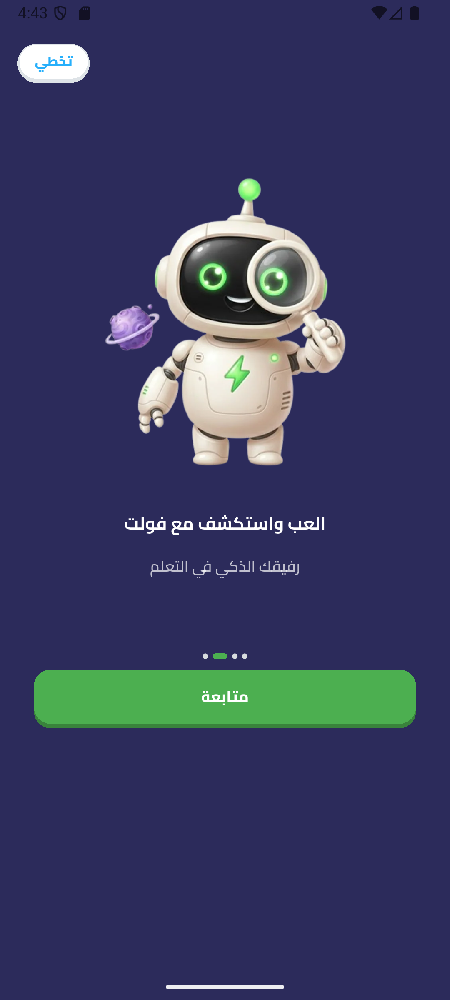
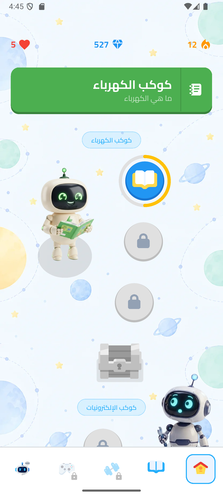
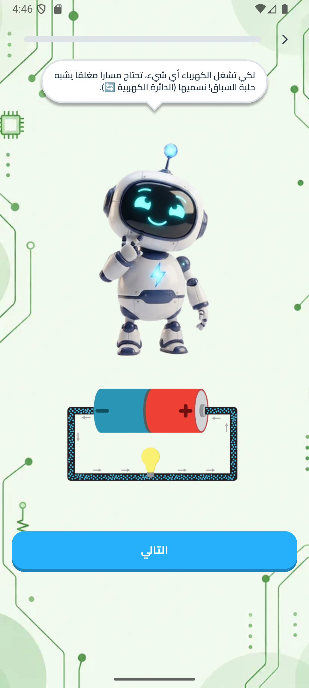

# 🚀 Volt (فولت)

> An interactive, gamified mobile learning platform built with Flutter and Dart, designed to empower young learners to master electrical circuits and electronics through engaging visual paths, robotic character mentors, diagnostic assessments, and AI-assisted guidance.

[](https://flutter.dev)
[](https://dart.dev)
[](#-architecture)
[](https://bloclibrary.dev)
[](#)

---

## 📱 What is Volt?

**Volt (فولت)** addresses a critical challenge in STEM education: electrical circuits, current, voltage, and components (such as resistors, batteries, LEDs, and potentiometers) are traditionally taught as abstract, theoretical concepts that can be intimidating for young students.

Volt transforms these fundamentals into an intuitive, gamified adventure. Tailored specifically for children and young learners in native Right-to-Left (RTL) Arabic, Volt provides a safe, guided environment where learners:
- Evaluate their initial knowledge through a diagnostic placement assessment.
- Progress along a Duolingo-style serpentine learning path with milestone rewards.
- Solve interactive multi-format quizzes with on-demand AI hints.
- Reinforce understanding through targeted quiz retry loops that isolate mistakes.

---

## ✨ Key Features

- 🗺️ **Gamified Serpentine Curriculum Map:** A winding, infinite-scroll learning roadmap procedurally generated using mathematical sine-wave algorithms (`math.sin`), complete with milestone chest nodes, animated bounce physics, unlockable levels, and parallax background scrolling.
- 🤖 **Interactive Robotic Character Mentors:** Character companions (`SpeakingRobot`) deliver conversational guidance, contextual reactions, and custom speech bubbles (`MessageShapeBorder`) with dynamic tail positioning.
- 💡 **AI-Assisted Contextual Hints:** Real-time AI hint integration (`api/quiz-attempts/{id}/questions/{qId}/hint`) providing conceptual hints directly inside a dedicated popup dialog without interrupting quiz state.
- 🔄 **Intelligent Mastery & Retry System:** Results view identifies mistaken answers and allows up to 3 focused retry attempts isolating only the failed questions, displaying previously unlocked hints.
- 📊 **Custom Canvas Radial Score Gauge:** Low-level `CustomPainter` rendering a semi-circular radial score gauge with mathematical arc calculations and earned XP badges.
- ⚡ **Resilient Offline Caching:** Two-tier caching combining HTTP disk caching via `dio_cache_interceptor` and `HiveCacheStore` with a programmatic `NetworkCacheManager` for targeted cache invalidation.
- 🔐 **Secure Session & Silent Token Refresh:** Hardware-backed token encryption via `FlutterSecureStorage` (Android Keystore / iOS Keychain) and automatic 401 token refresh using an isolated Dio instance.
- 🌍 **Native Arabic RTL Localization:** Built from the ground up for Arabic Right-to-Left layouts with the geometric **Cairo** font family and responsive typography scaling (`SizeConfig`) with clamped accessibility bounds.

---

## 🛠️ Technologies

1. **Flutter SDK & Dart 3.x** — Cross-platform UI framework and modern programming language leveraging pattern matching, records, and sound null safety.
2. **flutter_bloc & Cubit** — Feature-driven, predictable state management cleanly separating business logic from UI rendering.
3. **get_it** — High-performance Service Locator for Dependency Injection, managing lifecycle bounds between singletons and factory cubits.
4. **Dio & Custom Interceptors** — Robust HTTP networking client with custom interceptors for automated JWT authorization, response unwrapping, and silent token refresh.
5. **dio_cache_interceptor & http_cache_hive_store** — Offline HTTP disk caching backed by Hive key-value storage for fast, reliable data access.
6. **flutter_secure_storage** — Encrypted device storage utilizing Android Keystore and iOS Keychain to secure access and refresh tokens.
7. **shared_preferences** — Persistent key-value storage for application flags, onboarding status, and cached user profile metadata.
8. **dartz** — Functional programming constructs (`Either<Failure, T>`) enforcing strict compile-time error handling across the repository layer.
9. **json_annotation & json_serializable** — Automated code generation for strongly typed, null-safe JSON serialization.
10. **cached_network_image** — Efficient remote image caching, placeholder handling, and network asset management.
11. **flutter_svg & flutter_gen** — High-performance SVG vector graphics rendering and compile-time asset path code generation.
12. **CustomPainter & AnimationController** — Native Canvas 2D graphics programming for custom data visualizations and explicit ticker-driven sprite animations.

---

## 🏗️ Architecture

Volt implements a **Feature-First Layered Architecture with the Repository Pattern**, balancing clean separation of concerns with pragmatic developer velocity:

```
lib/
├── core/                         # Cross-cutting infrastructure & shared logic
│   ├── bloc_observer/            # Global BLoC lifecycle & error logging
│   ├── constants/                # App strings, auto-generated asset & font bindings
│   ├── di/                       # Dependency Injection via GetIt
│   ├── enums/                    # Strongly-typed domain & API enums
│   ├── env/                      # Environment variable abstraction (.env)
│   ├── errors/                   # Failure models & DioException mapping
│   ├── extensions/               # Responsive text, UI helpers, typed navigation
│   ├── models/                   # Shared DTOs (attempts, questions, user models)
│   ├── network/                  # Dio instance, interceptors, and network cache manager
│   ├── routing/                  # Centralized route definitions & onGenerateRoute factory
│   ├── shared_widgets/           # Custom canvas gauges, robot mascots, speech bubbles
│   ├── storage/                  # SharedPreferences & FlutterSecureStorage wrappers
│   ├── theme/                    # Color palette, text styles, and Material 3 theme
│   └── utils/                    # Pre-caching asset service, validators, responsive engine
└── features/                     # Self-contained business modules
    ├── auth/                     # Authentication, multi-step registration wizard, OTP reset
    ├── home/                     # Serpentine lesson path, milestone chests, progress tracking
    ├── lessons/                  # Multi-media content viewer & quizzing engine
    ├── placement_quiz/           # Diagnostic onboarding quiz & status verification
    ├── main_layout/              # Indexed navigation shell with custom bottom bar
    ├── onboarding/               # Multi-slide introductory walkthrough
    ├── profile/                  # User profile display & basic account information
    └── splash/                   # Cold-boot initialization, auth check & asset pre-caching
```

### Architectural Principles & Data Flow
- **Unidirectional Data Flow:** Views dispatch user actions to Cubits $\rightarrow$ Cubits invoke Repositories $\rightarrow$ Repositories fetch data from Remote or Local Data Sources $\rightarrow$ Results return to Cubits as `Either<Failure, T>` $\rightarrow$ UI updates reactively via `BlocBuilder` and `BlocListener`.
- **Fault-Tolerant Networking Pipeline:** An incoming request passes through the `AuthInterceptor` (JWT injection) $\rightarrow$ `CacheHeaderInjectorInterceptor` $\rightarrow$ `DioCacheInterceptor` (Hive store) $\rightarrow$ `ResponseUnwrapperInterceptor` (stripping `{ success: true, data: { ... } }` envelopes and converting API failures into structured errors).
- **Infinite Refresh Prevention:** The 401 refresh handler uses an independent, un-intercepted `tokenDio` client to execute token exchange, preventing recursive authorization loops.

---

## ⚙️ Tech Stack

| Category | Technologies |
| :--- | :--- |
| **Mobile Application** | Flutter SDK (v3.13+), Dart 3.x |
| **Architecture** | Feature-First Layered Architecture, Repository Pattern |
| **State Management** | BLoC / Cubit (`flutter_bloc`), `BlocObserver` |
| **Dependency Injection** | `get_it` Service Locator |
| **Networking & API** | Dio, Custom Interceptors (Silent Refresh, Envelope Unwrapping, Cache Header) |
| **Local Storage & Caching**| Hive (`http_cache_hive_store`), `dio_cache_interceptor`, `flutter_secure_storage`, `shared_preferences` |
| **Authentication** | JWT (Access & Refresh tokens) with Keystore/Keychain encryption |
| **UI & Graphics** | `CustomPainter` (Radial Gauges), `AnimationController`, Cairo Typography, `SizeConfig` |
| **Localization** | Native Arabic Right-to-Left (`Locale('ar')`) |
| **Code Generation** | `build_runner`, `json_serializable`, `flutter_gen` |

---

## 📸 Screenshots

| Onboarding & Auth | Learning Path | Lesson Content |
|:---:|:---:|:---:|
|  |  |  |


---

## 🎥 Demo Video

[▶️ Watch Application Demo](https://drive.google.com/file/d/1VrtQnOwtj1sUPYAY3i8zzq3XChc_2Eud/view?usp=drive_link)

---

## ⚡ Quick Start Guide

### Prerequisites
- [Flutter SDK](https://docs.flutter.dev/get-started/install) (`^3.13.0` or higher)
- [Dart SDK](https://dart.dev/get-dart) (`^3.13.0` or higher)
- Android Studio / VS Code with Flutter extensions
- Android SDK (API Level 21+) or Xcode for iOS development

### 1. Clone the Repository
```bash
git clone https://github.com/mohamedazzam36/Volt-App.git
cd Volt-App
```

### 2. Configure Environment Variables
Create a `.env` file in the project root directory:
```env
BASE_URL=https://your-api-endpoint.com/
GOOGLE_SERVER_CLIENT_ID=your-google-server-client-id
```

### 3. Install Dependencies
```bash
flutter pub get
```

### 4. Run Code Generation (Optional)
If modifying models or asset declarations, regenerate serialized classes:
```bash
dart run build_runner build --delete-conflicting-outputs
```

### 5. Run the Application
```bash
flutter run
```

---

## 🌍 Supported Platforms

- 🤖 **Android:** Supported and configured (`minSdk 21`, `targetSdk 34`, Kotlin JVM 17).
- 🍏 **iOS:** Supported and configured (iOS 12.0+, Apple Keychain capabilities).
